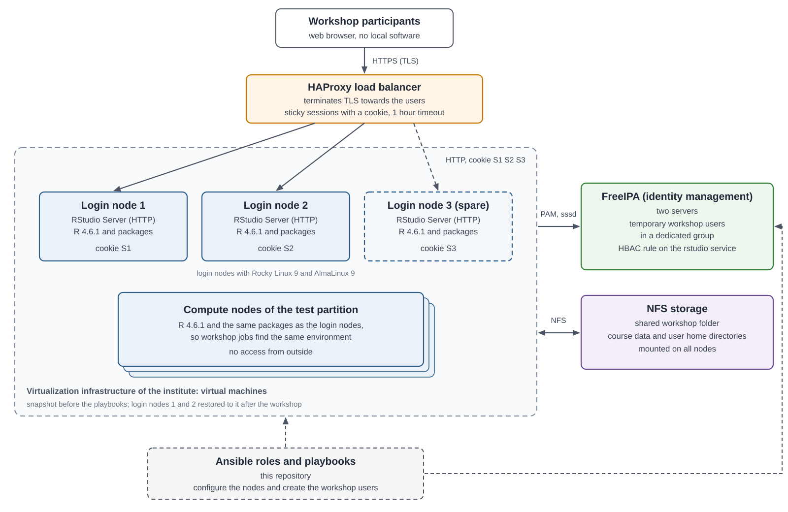

# R and RStudio Server for a hands-on workshop on an HPC cluster

Ansible roles and playbooks used at IRGB-CNR (Istituto di Ricerca Genetica e
Biomedica, Consiglio Nazionale delle Ricerche) to set up the analysis
environment of the hands-on workshop of the **Microbiome and Female Health
Symposium** (8–9 October 2026), organized by the Women4Health (W4H) project
team.

Participants worked from their own web browser through RStudio Server, with
nothing to install locally. Each of them had a personal, temporary account
managed by the institute's identity service (FreeIPA) and a personal working
area on shared network storage that also held the course data. The same
software stack (R 4.6 with CRAN and Bioconductor packages for multi-omics
analysis, plus the Python components some of them need) was installed
identically on all nodes of the test partition of the cluster, so interactive
sessions and batch jobs see the same environment.

The environment is described in the technical report IRGB-ERT-2026-008
(see [Citation](#citation)).

## What it sets up

- **R 4.6.1** from Posit binaries in `/opt/R/<version>` on all compute and
  login nodes; CRAN packages as binaries from Posit Public Package Manager,
  Bioconductor 3.23, everything in the system library. Package versions are
  pinned to the ones used at the workshop (`docs/package-versions.md`).
- **Packages** for the integrated microbiome–metabolome analysis: tidyverse,
  vegan, mixOmics, MOFA2, Maaslin2, maaslin3, mia (Bioconductor devel),
  anansi (GitHub) and others (`roles/r_base/defaults/main.yml`), plus a Python
  venv for reticulate (mofapy2) and Posit Python for the basilisk environments
  of MOFA2.
- **RStudio Server** (open source) on the login nodes only, plain HTTP behind
  a load balancer that terminates TLS and keeps each session on the same node.
- **Authentication** through PAM and sssd against FreeIPA, with an HBAC rule
  on the `rstudio` service. SELinux stays enforcing.
- **Workshop users**: `tuser001` … `tuser050`, anonymous (first name `Test`,
  last name equal to the user name), one random password each with a 15-day
  expiration, in a dedicated group, home directory on the shared folder.

## Architecture



Dashed lines: the spare login node and the configuration done by the
playbooks of this repository.

All machines are virtual machines: a snapshot taken before running the
playbooks is the restore point used after the workshop.

## Repository layout

| Path | Content |
|---|---|
| `roles/r_base` | R, system dependencies, packages, optional RStudio Server (tags `r_install`, `r_python`, `r_packages`, `r_rstudio`) |
| `roles/ipa_workshop_users` | temporary FreeIPA users: create, disable, delete |
| `playbooks/r-environment.yml` | NFS mount + `r_base` on compute and login nodes, RStudio on login nodes only |
| `playbooks/workshop-users.yml` | creates the workshop users, credentials in a local CSV |
| `playbooks/workshop-teardown.yml` | disables (or deletes) the workshop users |
| `inventory/example/` | example inventory and variables |
| `examples/haproxy-rstudio.cfg` | load balancer configuration used for RStudio |
| `docs/architecture.svg` | architecture diagram (Figure 1 of the technical report) |
| `docs/troubleshooting.md` | problems met during the setup and how the roles solve them |
| `docs/package-versions.md`, `.csv` | versions of the R and Python packages used at the workshop |

## Requirements

- Control node: ansible-core 2.14 or later and the collections in
  `requirements.yml`:

  ```bash
  ansible-galaxy collection install -r requirements.yml
  ```

- Nodes: Rocky Linux 9, AlmaLinux 9 or Ubuntu 22.04/24.04, enrolled in
  FreeIPA with mkhomedir. At the workshop the login nodes ran Rocky Linux 9
  and AlmaLinux 9: RStudio Server on Ubuntu is supported by the role but was
  not used there.
- An NFS export for the shared folder, writable for the home directories of
  the workshop users.
- In FreeIPA, created once by hand:

  ```bash
  ipa group-add workshop_users --desc "Workshop users"
  ipa pwpolicy-add workshop_users --maxlife=15 --priority=10
  ipa hbacsvc-add rstudio
  ipa hbacrule-add workshop_rstudio
  ipa hbacrule-add-user workshop_rstudio --groups=workshop_users
  ipa hbacrule-add-host workshop_rstudio --hosts=login-01.example.org --hosts=login-02.example.org
  ipa hbacrule-add-service workshop_rstudio --hbacsvcs=rstudio
  ```

  HBAC restricts access only if the default `allow_all` rule is disabled.
- A load balancer in front of the login nodes (`examples/haproxy-rstudio.cfg`).

## Usage

1. Copy `inventory/example` to `inventory/<site>` and set hosts, NFS export,
   load balancer address and the user range in `group_vars/all.yml`.
2. Take a snapshot of the virtual machines.
3. Install R, packages and RStudio Server. The first run takes a long time,
   because many Bioconductor packages are compiled (timeout
   `r_install_timeout`, 3 hours):

   ```bash
   ansible-playbook -i inventory/<site> playbooks/r-environment.yml
   ```

4. Create the workshop users (asks for the IPA admin credentials):

   ```bash
   ansible-playbook -i inventory/<site> playbooks/workshop-users.yml
   ```

   The credentials are written to `credentials/workshop_users.csv` on the
   control node (mode 0600, ignored by git). At the symposium they were handed
   over to three members of the organizing team, who gave each participant an
   account: the link between participant and account is known only to them.
5. Configure the load balancer and open it to the participants.

## After the workshop

This is how the environment was closed after the symposium:

1. Disable the workshop users:

   ```bash
   ansible-playbook -i inventory/<site> playbooks/workshop-teardown.yml
   ```

2. Close access from outside (load balancer).
3. Restore the login nodes used by the participants to their snapshot, to rule
   out any compromise resulting from their exposure to outside users and to
   reuse them from a clean state. Nodes that were not exposed to the
   participants, like the compute nodes, do not need it. The snapshot also rolls back the security configuration applied
   after it: apply your baseline again (hardening, audit, monitoring) and
   enroll the nodes in FreeIPA again before reusing them.
4. When the accounts are no longer needed, delete the users and the
   credentials file, then remove the home directories and course data from the
   shared folder:

   ```bash
   ansible-playbook -i inventory/<site> playbooks/workshop-teardown.yml -e tuser_state=absent
   ```

## Security notes

- No local users: RStudio Server authenticates through FreeIPA, with HBAC on
  the `rstudio` service.
- RStudio Server open source has no TLS: TLS terminates on the load balancer.
  Open the RStudio port on the login nodes only to the load balancer
  (`r_rstudio_firewall_sources`).
- SELinux stays enforcing: the only change is the `bin_t` label on the RStudio
  Server binaries.
- Workshop users are temporary and anonymous, in a dedicated group, removed
  from the default user group, with short-lived passwords. Passwords never go
  into the repository.
- Restrict SSH on the nodes (for example to administrative groups only), so
  that workshop users can reach the nodes only through RStudio.

## Known limitations

- R, Python and RStudio Server packages are downloaded over HTTPS from the
  Posit CDN without GPG signature verification.
- R package versions depend on the dated snapshots of Posit Public Package
  Manager (`r_p3m_snapshot`, `r_bioc_snapshot`). The dependencies of
  `mofapy2` are resolved by pip for the Python of each distro.
- `r_basilisk_python_version` must match the Python version pinned by MOFA2.
- The code is the one used for the symposium, with comments translated to
  English, site-specific values turned into variables and the package
  versions pinned (Bioconductor from Posit Public Package Manager instead of
  bioconductor.org, `user/repo@commit` for GitHub packages). The teardown part
  (`workshop-teardown.yml`, `tuser_state: disabled|absent`) was written
  afterwards and has not been run yet.

## Citation

If you use this repository, please cite it (see `CITATION.cff`) and the
technical report:

> D. Murrau, *Ambiente R e RStudio Server per il W4H Symposium*, technical
> report IRGB-ERT-2026-008, IRGB-CNR, 2026.

## AI assistance

This repository was prepared by the author with the help of the AI assistant Claude (Anthropic).

## License

MIT, see `LICENSE`.
